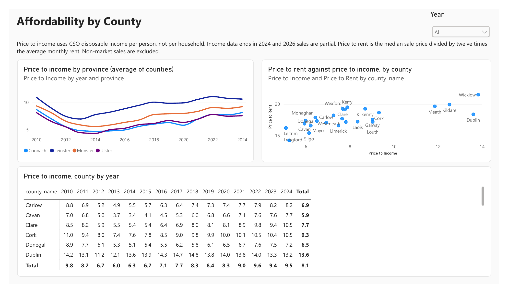
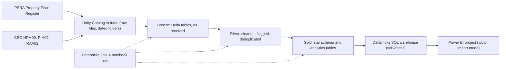

# Irish Housing Market Lakehouse

A Bronze, Silver and Gold lakehouse on Databricks built from public Irish housing data, with a Power BI report on the Gold layer.

Sources: Property Price Register (PSRA) and Central Statistics Office tables for the residential property price index, rent and county income.

## Report pages

### Market Overview


Median sale price by month (2010 onwards) next to the CSO residential property price index for National, Dublin and National excluding Dublin. Cards show median price, market sales, year on year change and the share of non-market sales. Slicers filter by year and new or second-hand homes.

### County Comparison


Median sale price for each of the 26 counties, with a detail table of market sales, year on year change and average monthly rent.

### Affordability


Price to income by province over time, a scatter chart of price to rent against price to income by county, and a county by year matrix. Income is CSO disposable income per person, not per household.

## Architecture



| Layer | What it holds |
|---|---|
| Bronze | Four tables, every column kept as text exactly as received, plus `_source_file` and `_load_date`. Row counts are reconciled against the source files on every run. |
| Silver | Prices and dates parsed, categories standardised, Irish language category text mapped to English, non-market and VAT exclusive sales flagged (not deleted), fully identical duplicate rows removed, a county reference table, and a data quality log. |
| Gold | Star schema: `fact_sale` (one row per registered sale), `fact_price_index`, `fact_rent`, `fact_income`, `dim_date`, `dim_county`, `dim_geography`, `dim_property_type`. Analytics tables: `county_year_affordability` and `sale_outliers`. |

The refresh is a Databricks Job with four notebook tasks (`notebooks/01_bronze.py` to `04_quality_checks.py`) that run in order. The last task fails the run if any error level data quality rule or the answer key check fails.

## Measured results

| Check | Result |
|---|---|
| Bronze rows vs source file lines | Property Price Register 813,106 = 813,106; HPM09 20,800 = 20,800; RIH02 674,352 = 674,352 |
| Silver sales after removing fully identical duplicates | 812,018 (1,088 duplicate rows removed) |
| Sales flagged non-market / VAT exclusive | 41,190 / 143,179 |
| Gold fact rows | `fact_sale` 812,018; `fact_price_index` 20,800; `fact_rent` 31,326; `fact_income` 650 |
| Gold vs Silver reconciliation | 4 of 4 fact tables match, no rows lost in joins |
| Independent SQL answer key (recomputed from Bronze) | 442 county and year cells compared (sales, market sales, median price), 0 mismatches |
| Sanity check on the index | 2015 average of the national index is 99.98 in both Bronze and Gold (base year 2015 = 100) |
| Automated checks in the pipeline | 27 data quality rules plus the answer key check |
| Unusual sales | 5,277 market sales flagged (2,703 low, 2,574 high) using a rule of 3 interquartile ranges on log price within county, year and new or second-hand group |
| Power BI model | 13 DAX measures, 1 calculation group (current, year on year, year on year percent, year to date) |

Price to income (median market sale price divided by disposable income per person):

| County | 2015 | 2020 | 2024 |
|---|---|---|---|
| Dublin | 13.9 | 14.0 | 13.2 |
| Cork | 7.8 | 10.0 | 10.5 |
| Leitrim | 3.8 | 4.5 | 6.8 |

## Which report page uses which table

| Page | Gold tables |
|---|---|
| Market Overview | `fact_sale`, `fact_price_index`, `dim_date`, `dim_geography`, `dim_property_type` |
| County Comparison | `fact_sale`, `fact_rent`, `dim_county`, `dim_date`, `dim_property_type` |
| Affordability | `county_year_affordability` (built from `fact_sale`, `fact_rent` and `fact_income`), `dim_county` |

The model also loads `sale_outliers` and has an `Outlier Sales` measure, but no report page uses them yet.

## Limitations

- The Property Price Register has typing errors, and some prices may not reflect full market value. Non-market sales are flagged and excluded from the headline medians.
- Most new home prices in the Register are VAT exclusive. They are shown as reported and not adjusted, because the VAT rate on some new apartments changed in October 2025.
- The CSO price index has no county level series outside Dublin, so county comparisons use Register medians and the index is shown for national, regional and Dublin trends.
- Income is disposable income per person, not per household, so price to income is best used to compare counties and years, not as a household affordability multiple. Income data ends in 2024 and 2026 sales are partial.
- Rent data is half yearly and about 70 percent of its rows have no value in the source. County level rent is used.
- Tipperary is not assigned to a CSO price index region.
- Removing fully identical rows assumes they are duplicates. Rows that are identical in every column could in principle be separate sales. A further 89 rows that share a date, address and price with another row but differ in another column are kept.
- Databricks Free Edition is for non-commercial use, with a limited serverless warehouse.

## Data sources and licences

- Property Price Register: copyright of the Property Services Regulatory Authority (PSRA), re-used under its Re-Use of Public Sector Information terms (psr.ie). The source and copyright are acknowledged here, the information is reproduced accurately, and this project is not a property price index. PSRA does not certify that the data is up to date or error free.
- Central Statistics Office tables HPM09 (Residential Property Price Index), RIH02 (RTB Average Monthly Rent Report) and RAA02 (county incomes): copyright of the CSO, licensed under Creative Commons Attribution 4.0 (CC BY 4.0).

## Repository layout

```
notebooks/     Bronze, Silver, Gold and quality check notebooks (Databricks source format)
powerbi/       Power BI project (.pbip): semantic model (TMDL) and report (PBIR)
images/        Report page screenshots
docs/          data_dictionary.csv (every column) and lineage.csv (source to Gold to report page)
```

## How to run

1. Create a Databricks Free Edition workspace and a catalog schema layout: `workspace.bronze`, `workspace.silver`, `workspace.gold`, plus a Volume `workspace.bronze.raw_files`.
2. Import the four notebooks and create a Job with four notebook tasks that depend on each other in order.
3. Open `powerbi/lakehouse.pbip` in Power BI Desktop and point the Databricks connection at your SQL warehouse.
